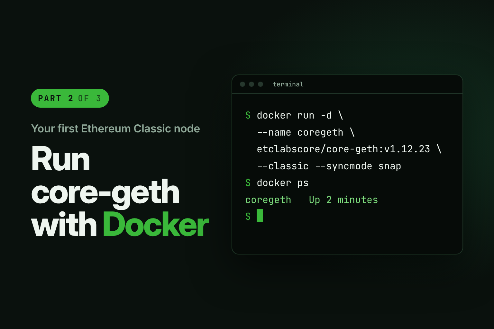
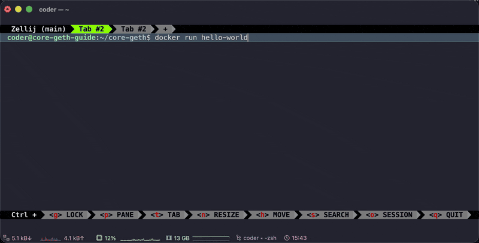
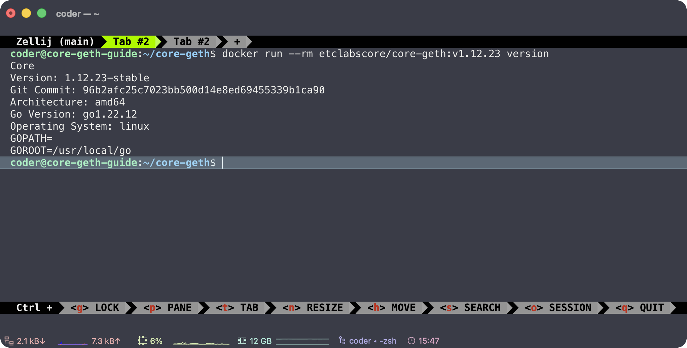
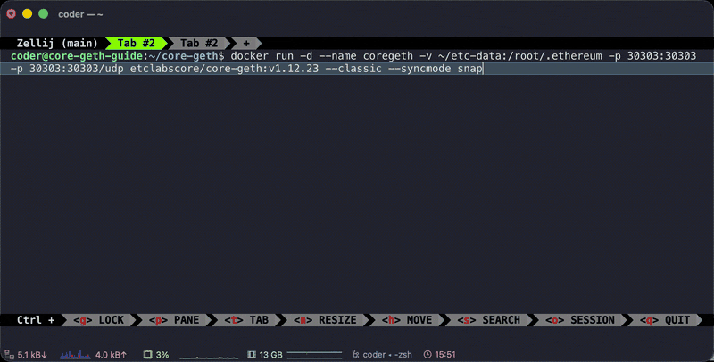
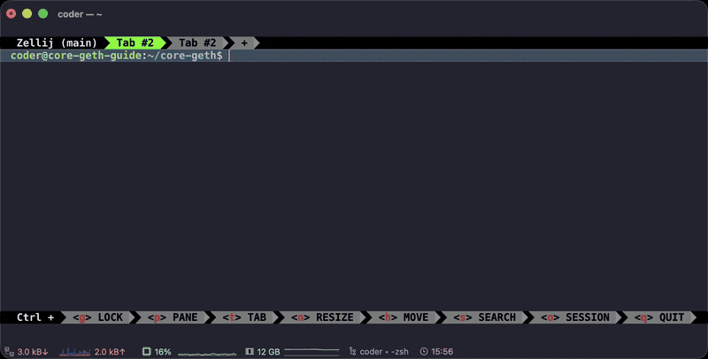
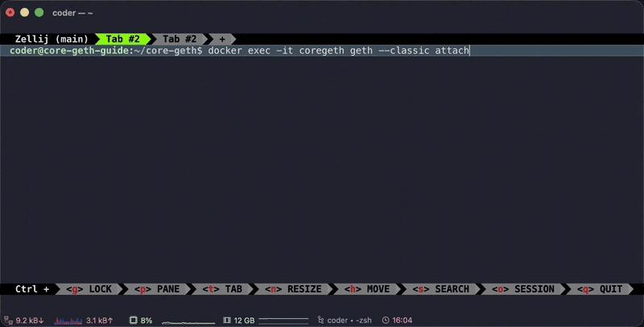

In [Part 1](/blog/2026-10-15-run-your-own-etc-node-part-1-build-core-geth-from-source), I showed you how to set up core-geth by building it from the source we got from GitHub. This time, we're going to use Docker.

Docker is a containerization tool. In layman's terms, it lets you spin up little self-contained boxes called containers on your machine and run them separately, for as long as you need them. Each container comes with everything its software needs to run. So instead of building core-geth yourself, you just download a ready-made image of it and run it. For this guide, we'll use the image for v1.12.23 "Argos", the latest stable release of core-geth as of writing.

Here's why that's handy for running a node:

- **Nothing to build.** core-geth comes ready-made in a Docker image, so you don't need to install Go or compile anything.
- **Kept separate.** Your node runs in its own container, apart from the rest of your system, so it won't clutter up your machine.
- **Runs the same everywhere.** The same image works the same way on any machine that has Docker.
- **Easy to update.** Moving to a newer version of core-geth means changing the version number in one command.
- **Easy to clean up.** When you're done, remove the container, and nothing is left behind except the chain data you chose to keep.

Docker can take a little more time to set up if you don't already have it installed. But once you do, starting core-geth takes one command, and talking to it takes one more.

This is part 2 of a three-part series. If you get stuck at any point, ask in [r/EthereumClassic](https://www.reddit.com/r/EthereumClassic/). The community is always happy to help.

**Not covered here:** waiting for a full sync, mining, or opening your node up to the internet. See [Next steps](#next-steps).

## Before you start

You need:

- A Linux machine running Ubuntu or Debian. This guide was recorded on a cloud Linux machine over SSH, but a virtual machine (VM) or a spare computer at home works the same way.
- An account that can run `sudo` (admin) commands.
- A terminal, and about 20 minutes, plus however long Docker takes to install.

**If you followed Part 1 and your node is still running, stop it first** ([Part 1, step 8](/blog/2026-10-15-run-your-own-etc-node-part-1-build-core-geth-from-source#step-8-stop-the-node-safely)). Both nodes use the same port, and the second one won't start while the first is running.

### Hardware

Recommended hardware for running core-geth with a snap sync on ETC mainnet, as of October 2026:

| | Recommended | Notes |
| --- | --- | --- |
| **CPU** | 4+ cores | A synced node uses less than one core |
| **RAM** | 16 GB+ | The client itself uses about 4 GB once synced. The extra covers the memory spike during the initial sync. Less can work with swap, but the sync is slower |
| **Disk** | 500 GB SSD or NVMe | A synced node uses about 85–100 GB today (chain data plus ethash caches). The rest leaves room for the chain to grow. Avoid spinning hard drives |
| **Internet** | 25+ Mbit/s download | Slower connections work, but the initial sync takes longer |

ETC's chain is much smaller than Ethereum's, so these numbers are well below [go-ethereum's hardware requirements](https://github.com/ethereum/go-ethereum#hardware-requirements) for Ethereum mainnet, which call for 2 TB or more of disk.

## Step 1: Install Docker

Install Docker by following Docker's official guide for your Linux version: [Install Docker Engine](https://docs.docker.com/engine/install/). Then do the first section of Docker's [post-installation steps](https://docs.docker.com/engine/install/linux-postinstall/), so you can use Docker without typing `sudo` every time.

**Check Docker works:**

```bash
docker run hello-world
```

**What you'll see** (among a few other lines):

```text
Hello from Docker!
This message shows that your installation appears to be working correctly.
```

**What it means:** Docker is installed and working, and your account can use it. If you see `permission denied`, log out and back in, then try again.



## Step 2: Download and check the core-geth image

```bash
docker run --rm etclabscore/core-geth:v1.12.23 version
```

**What you'll see:** the download first, the first time only:

```text
Unable to find image 'etclabscore/core-geth:v1.12.23' locally
v1.12.23: Pulling from etclabscore/core-geth
...
Status: Downloaded newer image for etclabscore/core-geth:v1.12.23
```

then a few lines of version details, including:

```text
Version: 1.12.23-stable
```

**What it means:** you have the right image, and it's the version you expect.

- `etclabscore/core-geth` is the image. core-geth's Docker images are published at [hub.docker.com/r/etclabscore/core-geth](https://hub.docker.com/r/etclabscore/core-geth).
- `v1.12.23` pins the exact version, so you always get the one this guide shows.
- `version` is the same command you'd run with a geth you built yourself. Anything after the image name goes to geth.
- `--rm` cleans up as soon as the command finishes.



## Step 3: Start your node with one command

First make a folder for the node's data:

```bash
mkdir -p ~/etc-data
```

**What you'll see:** nothing. Then start the node with this one (long) command:

```bash
docker run -d --name coregeth -v ~/etc-data:/root/.ethereum -p 30303:30303 -p 30303:30303/udp etclabscore/core-geth:v1.12.23 --classic --syncmode snap
```

**What you'll see:** one long string of letters and numbers, then your prompt comes back.

**What it means:** that string is your container's ID. Your node is now running in the background, so your prompt comes straight back and you can keep using the same terminal.

<details>
<summary>What each part of the command does</summary>

| Part | What it does |
| --- | --- |
| `-d` | Runs the node in the background |
| `--name coregeth` | Names the container, so later commands can refer to it |
| `-v ~/etc-data:/root/.ethereum` | Saves the chain data in `~/etc-data` on your machine, so it's kept even if the container is removed |
| `-p 30303:30303 -p 30303:30303/udp` | Opens the port other nodes use to connect to you |
| `etclabscore/core-geth:v1.12.23` | The image to run |
| `--classic --syncmode snap` | Everything after the image goes to geth: join Ethereum Classic, and use the fastest sync. [Part 1](/blog/2026-10-15-run-your-own-etc-node-part-1-build-core-geth-from-source#step-6-start-your-node) explains the sync modes |

Docker's own options always go before the image name. Anything after it goes to geth.

</details>



## Step 4: Check it's running

```bash
docker ps
```

**What you'll see:** a table with one row for `coregeth`, with a `STATUS` like `Up 2 minutes`.

**What it means:** your node is up and running. That's it: one command and you have a node! To watch what it's doing:

```bash
docker logs -f coregeth
```

**What you'll see:** lines of text scrolling as your node starts up, finds peers and begins to sync. A few `WARN` lines in the first minutes are normal, and during a snap sync you'll also see some `ERROR` lines such as `Expired request does not exist` or `Pending request exists for joining peer`. These are harmless as long as the node keeps syncing.

Press **Ctrl+C** to stop watching. That only stops the display: the node keeps running in the background.



## Step 5: Talk to your node

Wait about a minute after starting the node, then:

```bash
docker exec -it coregeth geth --classic attach
```

**What you'll see:** something like:

```text
Welcome to the Geth JavaScript console!

instance: CoreGeth/v1.12.23-stable...
...
To exit, press ctrl-d or type exit
>
```

**What it means:** you're in your node's console, inside the container. **From here, commands go to your node, not to Linux,** until you type `exit`.

Type each of these after the `>` and press Enter:

| Command | What you'll see | What it means |
| --- | --- | --- |
| `eth.chainId()` | `"0x3d"` | 61 in hexadecimal: ETC's chain ID. You're on Ethereum Classic |
| `net.peerCount` | A number, such as `7` | How many other nodes you're connected to. Anything above 0 means you're part of the network |
| `eth.syncing` | A block of details, including `currentBlock` and `highestBlock` | How far your node has synced. Shows `false` once it has caught up |
| `eth.blockNumber` | A number, often `0` during a snap sync | Normal at this stage. It jumps up near the end of the sync |

Type `exit` or press **Ctrl+D** to leave the console. Your node keeps running in the background. [Part 1, step 7](/blog/2026-10-15-run-your-own-etc-node-part-1-build-core-geth-from-source#step-7-talk-to-your-node-with-the-console) has more console commands and tips, and they all work here too.

**Keep your IP address private:** `admin.nodeInfo` shows your IP address, so keep its output out of posts and screenshots.



## Step 6: Stop, start and remove

To stop the node:

```bash
docker stop -t 120 coregeth
```

**What you'll see:** `coregeth` once it has stopped. `-t 120` gives it up to 2 minutes to shut down cleanly. Without it, Docker forces the node to stop after 10 seconds, which can damage the data.

To start it again:

```bash
docker start coregeth
```

Once it's stopped, you can remove the container:

```bash
docker rm coregeth
```

Your chain data stays in `~/etc-data` either way, so if you run the `docker run` command from step 3 again, your node carries on from where it left off.

Congratulations! You're running your own Ethereum Classic node with Docker. Once it's fully synced, you can query the blockchain directly, build your own block explorer, monitor the network, or create and deploy smart contracts and dApps, all without relying on a trusted third party or service.

## Troubleshooting

Find the message you're seeing, then follow the fix. Still stuck? Ask in [r/EthereumClassic](https://www.reddit.com/r/EthereumClassic/), and include the command you ran and the message you saw.

**`Cannot connect to the Docker daemon… Is the docker daemon running?`** Docker's background service isn't running. Start it with `sudo systemctl start docker`, then try again. If it still won't start, your machine may not allow Docker: some cloud workspaces don't. For anything else Docker-related, check Docker's own documentation: [Troubleshoot the Docker daemon](https://docs.docker.com/engine/daemon/troubleshoot/).

**`permission denied while trying to connect to the Docker daemon socket`.** You haven't logged out and back in since doing Docker's post-installation steps. Do that, or put `sudo` in front of the command.

**`The container name "/coregeth" is already in use`.** You already created the container. Start it with `docker start coregeth`, or remove it with `docker rm coregeth` and run the `docker run` command again.

**`address already in use` or `port is already allocated`.** Something else is using port 30303: usually a node from Part 1 (`address already in use`) or another container (`port is already allocated`). Stop it, then start your node with `docker start coregeth`. Docker created the container before the error, so running the `docker run` command again gives the `The container name "/coregeth" is already in use` error.

**`Error response from daemon: container … is not running`** when you run `docker exec`. The node isn't running. Start it with `docker start coregeth`, wait a minute, then try again.

## Next steps

- **Finish a full sync:** leave the node running until `eth.syncing` shows `false`. Check you have the disk space listed under Hardware first.
- **Restart it automatically:** add `--restart unless-stopped --stop-timeout 120` to the `docker run` command (before the image name). Docker then starts your node again after a reboot, and `--stop-timeout 120` gives it the same 2 minutes as step 6 to shut down cleanly when your machine restarts.
- **Update to a newer version:** when a new release comes out, stop and remove the container (step 6), then run the step 3 command again with the new version number in place of `v1.12.23`. Your chain data in `~/etc-data` carries over.
- **Free up the space:** remove the container (step 6), delete the image with `docker rmi etclabscore/core-geth:v1.12.23`, then delete the chain data with `sudo rm -rf ~/etc-data`. The files were created inside the container, so deleting them needs `sudo`.
